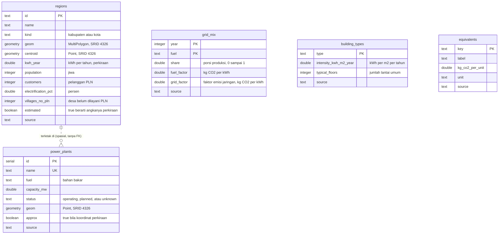
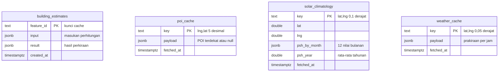
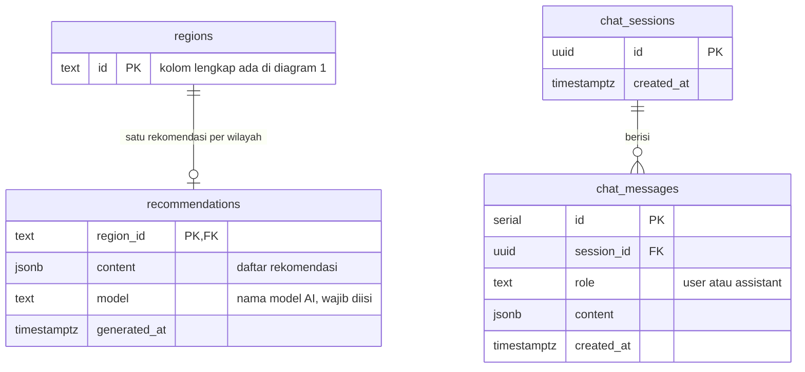

# ERD: basis data Malas Ngoding

Basis data memakai PostgreSQL 17 dengan ekstensi PostGIS 3.5 (image Docker `postgis/postgis:17-3.5`). Seluruh skema ada di satu berkas migrasi, `db/migrations/001_init.sql`, dan diterapkan oleh `bun run migrate` (juga oleh `bun run setup`). Diagram di bawah dibuat dari berkas itu dan dicocokkan dengan database hasil `bun run setup`: 12 tabel, semua kolom, kunci utama, kunci asing, dan kunci unik sama persis.

## Diagram

Diagram dipecah menjadi tiga kelompok supaya terbaca dalam satu halaman. Setiap tabel muncul penuh tepat satu kali. Tabel `regions` muncul lagi di diagram 3 hanya dengan kuncinya, untuk memperlihatkan kunci asing dari `recommendations`.

### Diagram 1: data wilayah dan listrik

Data acuan yang diisi oleh `bun run seed`.

### Diagram 2: cache layanan luar dan hasil hitungan

Tabel yang diisi server saat aplikasi dipakai. Tidak ada kunci asing: kuncinya teks yang dibentuk dari koordinat atau id gedung.

### Diagram 3: rekomendasi dan percakapan AI

## Cara membaca diagram

- `PK` kunci utama, `FK` kunci asing, `UK` kunci unik. Pada `grid_mix` kunci utamanya gabungan `year` dan `fuel`.
- Garis penuh adalah relasi kunci asing. `regions ||--o| recommendations` artinya satu wilayah punya nol atau satu baris rekomendasi (`recommendations.region_id` sekaligus kunci utama dan kunci asing). `chat_sessions ||--o{ chat_messages` artinya satu sesi punya nol atau banyak pesan; pesan ikut terhapus bila sesinya dihapus (`ON DELETE CASCADE`).
- Garis putus-putus adalah relasi spasial tanpa kunci asing: setiap pembangkit berada di dalam poligon satu wilayah. Hubungan ini dicari dengan fungsi PostGIS, bukan dengan kolom penghubung. Pada data seed, ke-13 pembangkit memang jatuh di dalam salah satu dari 10 wilayah.
- Tabel lain berdiri sendiri. Tabel cache memakai kunci teks yang dibentuk dari koordinat atau id gedung, sehingga tidak perlu kunci asing.
- `double` berarti `double precision`, `serial` berarti `integer` yang naik otomatis, dan `geometry` selalu punya subtipe dan SRID 4326 (WGS 84, bujur dan lintang) seperti tertulis di komentarnya.
- Selain 12 tabel ini, skrip `scripts/migrate.ts` membuat tabel `schema_migrations` (satu kolom `name`) untuk mencatat migrasi yang sudah diterapkan. Tabel itu bukan bagian dari berkas migrasi, jadi tidak digambar.

## Kelompok tabel

| Kelompok | Tabel | Diisi oleh |
|---|---|---|
| Data wilayah dan listrik | `regions`, `power_plants`, `grid_mix`, `building_types`, `equivalents` | `bun run seed`, dari `data/seed/*.json` dan `regions.geojson` |
| Cache layanan luar dan hasil hitungan | `building_estimates`, `poi_cache`, `solar_climatology`, `weather_cache` | Server, saat aplikasi dipakai (dan saat pemanasan cache) |
| AI | `recommendations`, `chat_sessions`, `chat_messages` | Server: rekomendasi pemerintah (saat dibuat Claude, juga oleh `bun run warm`) dan riwayat chat AI |

Isi seed saat ini: 10 wilayah, 13 pembangkit, 7 baris bauran listrik (satu per jenis bahan bakar, tahun 2024), 12 jenis bangunan, dan 5 faktor padanan. Seed memakai `INSERT ... ON CONFLICT DO UPDATE`, jadi aman dijalankan berulang.

## Kamus data

### regions

Sepuluh kabupaten dan kota di Kalimantan Timur. Batasnya dari geoBoundaries, angka listriknya perkiraan.

| Kolom | Tipe | Keterangan |
|---|---|---|
| `id` | text, PK | Slug wilayah, misalnya `kutai-kartanegara`. Dipakai di URL API dan chat. |
| `name` | text | Nama tampilan, misalnya `Kutai Kartanegara`. |
| `kind` | text | `kabupaten` atau `kota` (dibatasi `CHECK`). |
| `geom` | geometry(MultiPolygon, 4326) | Batas wilayah. Indeks GiST `regions_geom_gix`. |
| `centroid` | geometry(Point, 4326) | Titik di dalam wilayah (`ST_PointOnSurface`), selalu berada di dalam poligonnya. Indeks GiST `regions_centroid_gix`. |
| `kwh_year` | double precision | Listrik terpakai per tahun dalam kWh, perkiraan. Cara menghitungnya ada di `architecture.md`. |
| `population` | integer, boleh kosong | Proyeksi penduduk BPS 2025. |
| `customers` | integer, boleh kosong | Pelanggan PLN 2024 (BPS). |
| `electrification_pct` | double precision, boleh kosong | Rasio elektrifikasi 2024 (BPS), dalam persen. |
| `villages_no_pln` | integer, boleh kosong | Desa belum dilayani PLN. Hanya Kutai Barat dan Mahakam Ulu yang terisi. |
| `estimated` | boolean | `true` untuk perkiraan. Antarmuka menampilkan kata "perkiraan" di samping angkanya. |
| `source` | text | Asal angka dan metode penghitungannya. |

Emisi CO2 wilayah tidak disimpan. Server menghitungnya saat dibaca: `kwh_year` dikali faktor emisi terbaru dari `grid_mix`.

### power_plants

| Kolom | Tipe | Keterangan |
|---|---|---|
| `id` | serial, PK | |
| `name` | text, unik | Nama pembangkit. Seed memakai nama ini untuk `ON CONFLICT`. |
| `fuel` | text | Salah satu `batubara`, `gas`, `diesel`, `surya`, `air`, `biomassa`, `lainnya`. Tidak dibatasi `CHECK`; nilainya dijaga oleh tipe `FuelType` di kode. |
| `capacity_mw` | double precision | Kapasitas terpasang (MW). |
| `status` | text | `operating`, `planned`, atau `unknown` (captive atau belum terverifikasi). |
| `geom` | geometry(Point, 4326) | Lokasi. Indeks GiST `power_plants_geom_gix`. |
| `approx` | boolean | `true` bila koordinat berupa perkiraan. Berlaku untuk 9 dari 13 pembangkit; peta menampilkannya sebagai "Lokasi perkiraan". |
| `source` | text | Sumber kapasitas dan koordinat. |

### grid_mix

Bauran listrik jaringan Kalimantan Timur dan faktor emisinya. Tiap tahun punya satu baris per bahan bakar, dan server memakai tahun terbaru.

| Kolom | Tipe | Keterangan |
|---|---|---|
| `year`, `fuel` | integer dan text, PK gabungan | Tahun data dan jenis bahan bakar. |
| `share` | double precision | Porsi produksi listrik, 0 sampai 1 (jumlah semua bahan bakar = 1). |
| `fuel_factor` | double precision | Emisi per kWh untuk bahan bakar itu, dalam kg CO2/kWh. |
| `grid_factor` | double precision | Faktor emisi resmi jaringan (1,14 kg CO2/kWh). Nilainya sama di semua baris pada tahun yang sama. |
| `source` | text | Sumber faktor, bauran, dan metodenya. |

### building_types

| Kolom | Tipe | Keterangan |
|---|---|---|
| `type` | text, PK | Salah satu dari 12 jenis: `rumah`, `ruko`, `kantor`, `pemerintahan`, `sekolah`, `kampus`, `rumah_sakit`, `hotel`, `mal`, `ibadah`, `gudang`, `industri`. |
| `intensity_kwh_m2_year` | double precision | Intensitas listrik (kWh per m² lantai per tahun). |
| `typical_floors` | integer | Jumlah lantai umum, dipakai bila peta tidak punya tinggi gedung. |
| `source` | text | Survei atau asumsi di balik angka itu. |

### equivalents

Faktor untuk mengubah kilogram CO2 menjadi padanan yang mudah dibayangkan.

| Kolom | Tipe | Keterangan |
|---|---|---|
| `key` | text, PK | `mobil_km`, `motor_km`, `pohon`, `charge_hp`, atau `penerbangan`. |
| `label` | text | Teks tampilan, misalnya "km naik mobil". |
| `kg_co2_per_unit` | double precision | Kilogram CO2 per satu satuan padanan. |
| `unit` | text | Satuan: `km`, `pohon`, `kali`, atau `penumpang`. |
| `source` | text | Sumber faktor. |

### building_estimates

Cache perkiraan per gedung.

| Kolom | Tipe | Keterangan |
|---|---|---|
| `feature_id` | text, PK | Kunci cache: id gedung, pilihan pengguna (jenis, lantai), luas lantai dasar yang dibulatkan, dan kelas POI, dipisah `\|`. Luas atau POI yang berubah menghasilkan kunci baru. |
| `input` | jsonb | Masukan yang dipakai (`BuildingInput`). |
| `result` | jsonb | Hasil (`BuildingEstimate`). |
| `created_at` | timestamptz | Waktu disimpan. Tidak ada masa berlaku. |

### poi_cache

| Kolom | Tipe | Keterangan |
|---|---|---|
| `key` | text, PK | Koordinat `lng,lat` dibulatkan ke 5 desimal (sekitar 1 m). |
| `payload` | jsonb | `{ "poi": ... }` berisi POI terdekat dalam radius 25 m, atau `null` bila tidak ada. Hasil "tidak ada POI" juga disimpan. |
| `fetched_at` | timestamptz | Waktu diambil dari Mapbox. |

### solar_climatology

Rata-rata radiasi matahari jangka panjang dari NASA POWER.

| Kolom | Tipe | Keterangan |
|---|---|---|
| `key` | text, PK | `lat,lng` dibulatkan ke 0,1 derajat. |
| `lat`, `lng` | double precision | Koordinat titik yang diminta. |
| `psh_by_month` | jsonb | 12 nilai jam puncak matahari (kWh/m²/hari), Januari sampai Desember. |
| `psh_year` | double precision | Rata-rata tahunan, dipakai untuk simulasi surya. |
| `fetched_at` | timestamptz | Waktu diambil dari NASA POWER. Data ini tidak kedaluwarsa. |

### weather_cache

| Kolom | Tipe | Keterangan |
|---|---|---|
| `key` | text, PK | `lat,lng` dibulatkan ke 0,05 derajat (sekitar 5 km). |
| `payload` | jsonb | `{ "hours": [...] }`, prakiraan per jam selama 7 hari. |
| `fetched_at` | timestamptz | Dipakai untuk masa segar 1 jam. Bila Open-Meteo gagal, data lama tetap dipakai dan ditandai usang. |

### recommendations

Rekomendasi untuk pemerintah daerah yang ditulis Claude, satu baris per wilayah. Baris ini hanya ditulis bila Claude berhasil dan jawabannya lolos pemeriksaan.

| Kolom | Tipe | Keterangan |
|---|---|---|
| `region_id` | text, PK dan FK ke `regions.id` | |
| `content` | jsonb | Objek `{ "items": [...] }`; tiap butir berisi judul, kategori, isi, dampak, dan prioritas 1 sampai 3 (3 sampai 6 butir). |
| `model` | text, **NOT NULL** | Nama model AI yang menulis baris itu, misalnya `claude-sonnet-5-5`. Kolom ini tidak pernah kosong. |
| `generated_at` | timestamptz | Waktu dibuat atau dibuat ulang. |

Rekomendasi berbasis aturan (cadangan saat AI tidak ada atau gagal) tidak punya baris di tabel ini. Server menyusunnya saat dibaca dan mengirimnya dengan `model: null` di jawaban API, tetapi tidak menyimpannya, sehingga permintaan berikutnya mencoba Claude lagi. Jadi nilai kosong untuk `model` hanya ada di jawaban API, bukan di basis data. Hasil yang ditulis dengan jam matahari cadangan (NASA POWER gagal) juga tidak disimpan.

### chat_sessions dan chat_messages

Riwayat chat AI per sesi anonim.

| Kolom | Tipe | Keterangan |
|---|---|---|
| `chat_sessions.id` | uuid, PK | Dibuat otomatis (`gen_random_uuid()`). Browser menyimpannya di `localStorage`. |
| `chat_sessions.created_at` | timestamptz | |
| `chat_messages.id` | serial, PK | |
| `chat_messages.session_id` | uuid, FK ke `chat_sessions.id` | `ON DELETE CASCADE`. |
| `chat_messages.role` | text | `user` atau `assistant` (dibatasi `CHECK`). |
| `chat_messages.content` | jsonb | Pesan pengguna: `{ "text": ... }`. Jawaban asisten: `{ "text": ..., "actions": [...] }` dengan aksi peta yang dijalankannya. |
| `chat_messages.created_at` | timestamptz | Indeks `chat_messages_session_idx` pada `(session_id, id)` mempercepat pembacaan riwayat. |

## PostGIS di aplikasi

| Fungsi PostGIS | Dipakai untuk | Lokasi |
|---|---|---|
| `ST_Intersects`, `ST_MakePoint`, `ST_SetSRID` | Mencari wilayah dari titik yang diklik (`regionAt`). Titik di luar semua poligon berarti "Di luar Kalimantan Timur". | `src/server/db.ts` |
| `ST_Dump`, `ST_Area(geography)`, `ST_Collect`, `ST_Multi` | Membuang pulau dan delta kecil (di bawah 30 km²) dari geometri tampilan, supaya kolom tidak berbentuk pagar tipis. Pencarian wilayah tetap memakai geometri penuh. | `regionGeoJSON` di `src/server/db.ts` |
| `ST_MaximumInscribedCircle` | Titik label nama wilayah: pusat lingkaran terbesar di dalam wilayah, jadi selalu di dalam wilayah. | `regionGeoJSON` |
| `ST_AsGeoJSON` | Mengirim geometri ke peta sebagai GeoJSON (6 desimal). | `src/server/db.ts` |
| `ST_GeomFromGeoJSON`, `ST_MakeValid`, `ST_PointOnSurface` | Memuat batas wilayah dari `regions.geojson` dan menghitung `centroid`. | `scripts/seed.ts` |
