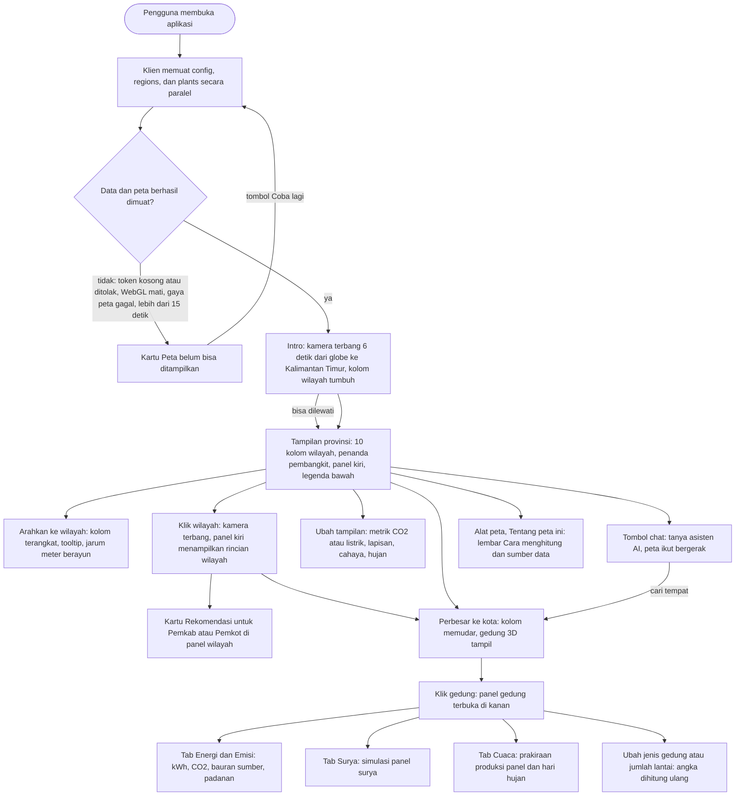
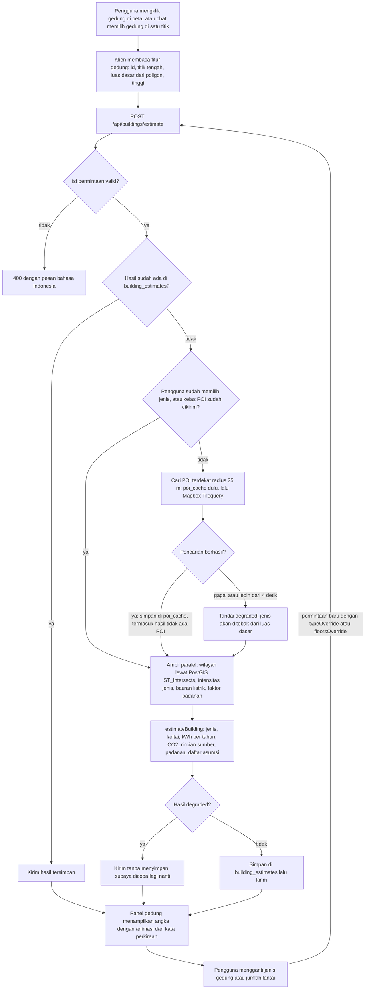
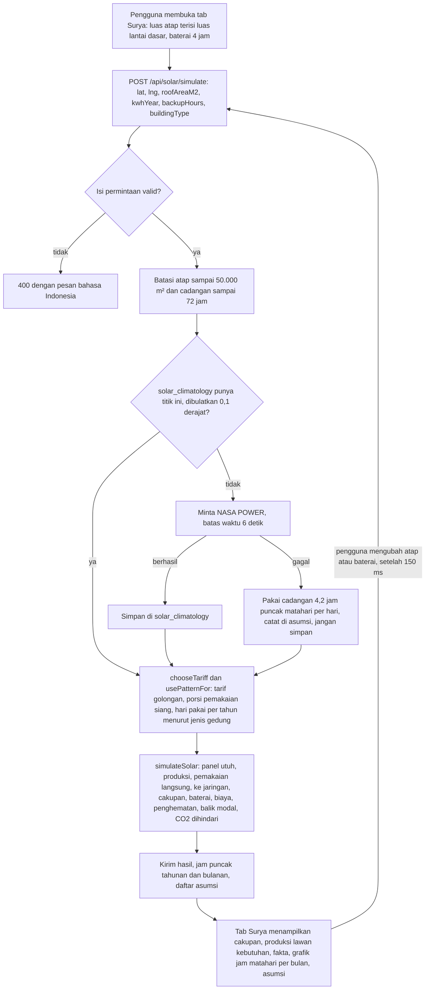
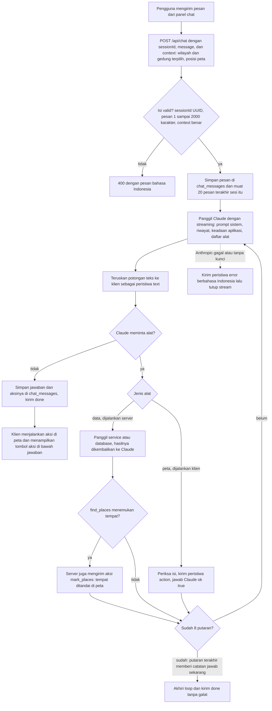
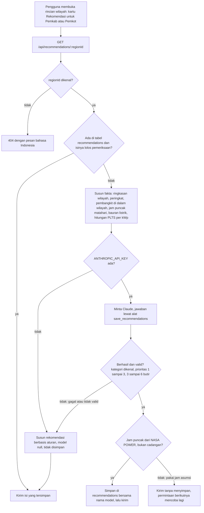
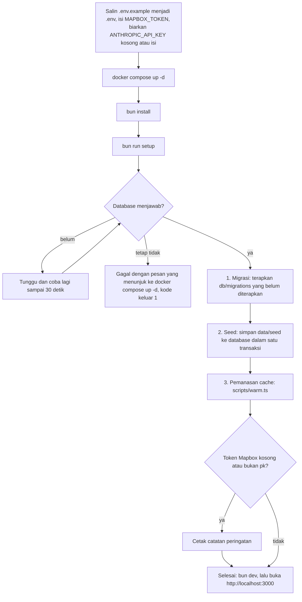

# Alur aplikasi dan flowchart

Dokumen ini memuat alur pemakaian aplikasi dan flowchart tiap fitur utama. Diagram memakai Mermaid, jadi tampil langsung di GitHub dan bisa diekspor ke gambar untuk PDF. Semua langkah di sini sudah dicocokkan dengan kode di cabang `main`.

Isi dokumen:

1. [Alur aplikasi](#1-alur-aplikasi)
2. [Klik gedung sampai perkiraan](#2-klik-gedung-sampai-perkiraan)
3. [Simulasi panel surya](#3-simulasi-panel-surya)
4. [Prakiraan cuaca dan hujan](#4-prakiraan-cuaca-dan-hujan)
5. [Chat AI dan loop alat](#5-chat-ai-dan-loop-alat)
6. [Rekomendasi untuk pemerintah](#6-rekomendasi-untuk-pemerintah)
7. [Alur pemasangan lokal](#7-alur-pemasangan-lokal)

## 1. Alur aplikasi

Gambaran perjalanan pengguna, dari membuka aplikasi sampai memakai semua fitur.

Beberapa aturan di alur ini:

- Tiga permintaan awal (`/api/config`, `/api/regions`, `/api/plants`) berjalan paralel. Bila salah satu gagal, atau token Mapbox kosong, pengguna melihat kartu "Peta belum bisa ditampilkan" dengan tombol "Coba lagi", bukan layar kosong.
- Intro bisa dilewati dengan tombol "Lewati intro", tombol Esc, spasi, Enter, atau gerakan apa pun di peta. Bila sistem meminta gerak dikurangi, kamera langsung melompat.
- Kolom wilayah memendek mulai pembesaran 6,6 dan hilang di pembesaran 12, saat gedung 3D Mapbox mengambil alih.
- Cahaya peta mengikuti jam WITA (fajar, siang, senja, malam) kecuali presenter mengunci lewat saklar "Cahaya" atau `?cahaya=`.
- Panel gedung dan kartu rekomendasi hanya muncul sesudah pengguna memilih gedung atau wilayah. Chat bisa membukanya sendiri lewat aksi peta.
- Setiap angka perkiraan diberi kata "perkiraan".

## 2. Klik gedung sampai perkiraan

Dari klik pada sebuah gedung sampai angka listrik, CO2, dan padanannya. Alurnya sama untuk klik langsung dan untuk gedung yang dipilih chat (aksi `select_building_at`).

Langkah di klien (`src/web/map/buildings.ts`, `src/web/store.ts`, `src/web/panels/BuildingPanel.tsx`):

1. **Klik.** Peta memakai `map.addInteraction` pada featureset `buildings` milik Mapbox Standard. Klien menghitung luas dasar dari poligon gedung (luas bola, dibulatkan ke m²), mengambil tinggi dari properti `height`, dan memakai titik tengah poligon terbesar sebagai lokasi. Tinggi 3 m (bawaan Mapbox untuk tinggi yang tidak diketahui) dianggap tidak diketahui. Id gedung berupa `mapbox:<id>`, atau kunci dari titik tengah bila tidak ada id.
2. **Panel.** Panel terbuka dengan kerangka pemuatan, lalu menampilkan jenis gedung (daftar pilihan 12 jenis), jumlah lantai (1 sampai 40), angka listrik per tahun, dan empat tab: Energi, Emisi, Surya, Cuaca. Klik di tanah kosong pada pembesaran 14 atau lebih, tombol tutup, atau Esc menutup panel.
3. **Mengubah jenis atau lantai.** Pilihan jenis langsung meminta perkiraan baru. Jumlah lantai menunggu 300 ms setelah tombol terakhir ditekan. Selama menunggu, panel tetap menampilkan angka terakhir. Jenis baru memakai jumlah lantai umum jenis itu, kecuali pengguna sudah mengatur lantai.
4. **Gagal.** Bila server tidak menjawab, panel menampilkan "Perkiraan gedung gagal dimuat" dengan tombol "Coba lagi". Bila tidak ada gedung di titik pilihan chat, panel menampilkan "Gedung tidak ditemukan".
5. **Di luar Kalimantan Timur.** Panel menulis "Di luar Kalimantan Timur" dan tetap menampilkan perkiraan dengan faktor emisi Kaltim.

Langkah di server (`src/server/routes/buildings.ts` dan `src/shared/estimate.ts`):

1. **Periksa isi.** `featureId`, `lng`, `lat`, dan `footprintM2` wajib ada dan bertipe benar. `typeOverride` dan `typeHint` harus salah satu dari 12 jenis. Isi yang salah dijawab 400.
2. **Cache.** Kunci cache memuat versi bentuk hasil, id gedung, pilihan pengguna (jenis, lantai), luas dasar yang dibulatkan, kelas POI, dan petunjuk jenis dari pencarian tempat. Bila salah satunya berubah, hasil dihitung ulang.
3. **Jenis gedung.** Bila pengguna memilih jenis atau klien sudah mengirim kelas POI, pencarian POI dilewati. Bila tidak, server mencari POI terdekat dalam radius 25 m (`poi_cache`, lalu Tilequery). Kelas POI diubah menjadi jenis gedung (misalnya `education` tipe `school` menjadi `sekolah`). Tanpa POI yang cocok, jenis memakai petunjuk dari pencarian tempat chat bila ada (`typeHint`, misalnya gedung sekolah yang ditemukan lewat `find_places`). Bila tidak ada petunjuk, jenis ditebak dari luas dasar: di bawah 250 m² rumah, di bawah 2.000 m² ruko, selebihnya gudang. Tebakan dan petunjuk itu dicatat di daftar asumsi.
4. **Jumlah lantai.** Bila peta punya tinggi lebih dari 3 m: tinggi ÷ 3,5 m dibulatkan. Bila tidak, dipakai jumlah lantai umum jenis itu. Hasilnya dijepit ke 1 sampai 40.
5. **Energi dan emisi.** `kWh per tahun = luas dasar × lantai × intensitas jenis`, `CO2 = kWh × 1,14 kg/kWh`. Rincian per sumber (batu bara, gas, diesel, dan lain-lain) dibagi menurut bauran listrik tetapi totalnya disamakan dengan angka resmi. Padanan (km mobil, motor, pohon, charge HP, penerbangan) dihitung dari kg CO2.
6. **Wilayah.** PostGIS mencari wilayah yang memuat titik itu. Di luar Kalimantan Timur hasilnya `region: null`, dan perkiraan tetap dibuat dengan faktor emisi Kaltim (dicatat di daftar asumsi).
7. **Luas ekstrem.** Luas dasar dijepit ke 10 sampai 50.000 m² supaya tidak ada `NaN` atau angka tak masuk akal.
8. **Simpan.** Hasil disimpan kecuali pencarian POI gagal (`degraded`), supaya perkiraan tanpa data POI tidak menempel di cache.

Rumus dan tabel angkanya ada di [architecture.md](architecture.md#4-perkiraan-satu-gedung).

## 3. Simulasi panel surya

Dari luas atap dan konsumsi listrik gedung sampai biaya dan balik modal. Tarif listrik dan jam pemakaian mengikuti jenis gedung, jadi dua gedung dengan listrik yang sama bisa punya hasil berbeda. Tab Surya di panel gedung dan alat chat `simulate_solar` memakai fungsi server yang sama (`simulateSolarAt`), jadi angkanya sama.

Langkah di server (`src/server/routes/solar.ts`, `src/server/services/solarTariff.ts`, `src/shared/solar.ts`):

1. **Periksa isi.** `lat` dan `lng` dalam rentang, `roofAreaM2` dan `kwhYear` lebih dari 0, `backupHours` 0 atau lebih, dan `buildingType` (bila ada) salah satu dari 12 jenis. Atap dibatasi 50.000 m² dan cadangan 72 jam.
2. **Radiasi matahari.** Rata-rata tahunan `ALLSKY_SFC_SW_DWN` dari NASA POWER (klimatologi 25 tahun, kWh/m²/hari, yaitu jam puncak matahari) di titik gedung. Hasil disimpan permanen per titik 0,1 derajat. Bila NASA POWER tidak terjangkau dan belum ada cache, dipakai 4,2 jam per hari dengan catatan di daftar asumsi, dan nilai itu tidak disimpan.
3. **Tarif menurut jenis gedung.** Rumah memakai R-1/TR 1.300 VA (Rp 1.444,70 per kWh). Kantor pemerintah memakai P-1 (Rp 1.699,53), atau P-2 (Rp 1.522,88) bila listriknya di atas 600 MWh per tahun. Ruko, kantor, hotel, mal, dan gudang memakai B-2 (Rp 1.444,70), atau B-3 (Rp 1.114,74, harga di luar beban puncak) di atas 600 MWh per tahun. Industri memakai I-3 (Rp 1.114,74). Sekolah, kampus, rumah ibadah, dan rumah sakit biasanya memakai tarif sosial yang belum dimodelkan, jadi dipakai tarif rumah tangga dan asumsinya mengatakan penghematan sebenarnya bisa lebih kecil. Jenis yang tidak diketahui dihitung sebagai rumah tangga.
4. **Pemakaian siang dan hari pakai.** Panel hanya menghemat listrik yang dipakai saat matahari bersinar, karena kelebihan ke jaringan PLN tidak mengurangi tagihan (Permen ESDM 2/2024). Tiap jenis punya porsi pemakaian siang (misalnya kantor 85%, rumah 40%) dan jumlah hari pakai per tahun (misalnya kantor 250, sekolah 200, ruko 330, rumah 365). Di hari libur gedung memakai beban dasar sekitar 15% dari hari biasa. Semuanya asumsi dan dicatat di daftar asumsi.
5. **Ukuran sistem.** Hasil per kWp = PSH × 365 × 0,78. Jumlah panel dipilih sebesar pemakaian siang setahun (dalam panel utuh 0,55 kWp), tetapi tidak melebihi muatan atap (60% luas atap ÷ 5,5 m² per kWp).
6. **Hasil.** Produksi per tahun, bagian yang dipakai langsung di gedung dan bagian yang masuk jaringan tanpa imbalan, cakupan kebutuhan (pemakaian langsung ÷ listrik setahun), ukuran baterai untuk jam cadangan yang dipilih, biaya (Rp 15 juta per kWp dan Rp 2,5 juta per kWh baterai), penghematan (pemakaian langsung × tarif), balik modal sederhana (juga tanpa baterai), dan CO2 yang dihindari (pemakaian langsung × 1,13 kg/kWh, faktor khusus PLTS di Sistem Mahakam).
7. **Asumsi ikut dikirim.** Golongan tarif, porsi siang, hari pakai, catatan ekspor, harga, catatan baterai, dan faktor CO2 ada di `assumptions`, supaya angka tidak tampil tanpa dasar.

Batasan metodenya (neraca per jenis hari, balik modal sederhana) dijelaskan di [architecture.md](architecture.md#6-simulasi-panel-surya).

## 4. Prakiraan cuaca dan hujan

Dua hal yang berkaitan dengan cuaca: prakiraan produksi panel di tab Cuaca (data dari Open-Meteo) dan efek hujan di peta, yang bisa menyala sendiri saat turun hujan di tempat yang dilihat.

```mermaid
flowchart TD
  subgraph Data["Tab Cuaca: prakiraan produksi panel"]
    A["Tab Cuaca memakai ukuran panel dari tab Surya, atau menjalankan simulasi bawaan"] --> A1["GET /api/weather dengan lat, lng, dan kWp"]
    A1 --> B{"lat, lng, kWp valid?"}
    B -->|tidak| B1["400 dengan pesan bahasa Indonesia"]
    B -->|ya| C{"weather_cache titik ini, dibulatkan 0,05 derajat, masih segar kurang dari 1 jam?"}
    C -->|ya| F
    C -->|tidak| D["Minta Open-Meteo: radiasi, awan, hujan, kode cuaca per jam, 7 hari, batas waktu 6 detik"]
    D -->|berhasil| E["Simpan di weather_cache"]
    E --> F
    D -->|gagal| D1{"Ada cache lama?"}
    D1 -->|ya| D2["Pakai cache lama dan tandai stale true"]
    D2 --> F
    D1 -->|tidak| D3["503: Prakiraan cuaca sedang tidak tersedia, tab menampilkan pesannya dan tombol Coba lagi"]
    F["pvFromForecast: kWp x radiasi per 1.000 x 0,78 tiap jam, ringkasan harian, kondisi saat ini"] --> G["Jawaban: hours, days, current, stale"]
    G --> H["Tab: baris Sekarang, grafik 72 jam dengan jam hujan diarsir, daftar produksi per hari"]
    H --> H1["Tiap hari dibandingkan dengan langit cerah di titik itu (model Haurwitz): produksi turun berapa persen dan sebabnya"]
  end

  subgraph Peta["Efek hujan di peta"]
    R1{"Mode hujan"} -->|"Hujan dinyalakan di kontrol peta"| R2["Efek hujan menyala lewat map.setRain"]
    R1 -->|"Otomatis, bawaan"| R3["Pada pembesaran 12 atau lebih: cek GET /api/weather di pusat peta, saat mulai, setelah kamera pindah lebih dari 2 km, dan tiap 10 menit"]
    R3 -->|"current.raining bernilai true dan prakiraan masih berlaku"| R2
    R2 --> R4{"Pembesaran 15 atau lebih?"}
    R4 -->|tidak| R5["Hujan belum terlihat, keterangan di bawah saklar meminta peta diperbesar sampai tingkat gedung"]
    R4 -->|ya| R6["Garis hujan tipis, di peta terang ditambah kabut, dan tint mendung"]
  end
```

Aturan penting:

- **Open-Meteo** dipanggil dengan variabel `shortwave_radiation`, `cloud_cover`, `precipitation`, dan `weather_code`, zona waktu Asia/Makassar (WITA), 7 hari. Titik dibulatkan ke 0,05 derajat (sekitar 5 km) agar banyak klik berdekatan memakai satu cache.
- **Produksi panel per jam** = kWp × radiasi ÷ 1.000 × 0,78. Mendung dan hujan sudah tercermin di nilai radiasi.
- **Jam hujan.** Satu jam dianggap hujan bila curahnya 0,1 mm atau lebih atau kode cuacanya hujan. Aturan yang sama dipakai untuk "sedang hujan sekarang", grafik jam hujan, dan efek hujan di peta.
- **Hari hujan di tab Cuaca.** Hujan dan awan dihitung hanya pada jam siang (hujan malam tidak mengurangi produksi). Satu hari berlabel "Hujan" bila ada 2 jam hujan di siang hari atau curah 1 mm atau lebih, "Berawan" bila rata-rata awan siang 60% atau lebih, selebihnya "Cerah". Penurunan dihitung terhadap produksi panel yang sama di bawah langit cerah (model Haurwitz). Selisih di bawah 10% ditulis "hampir sama dengan langit cerah (model)", karena model itu tidak punya kabut atau kelembapan.
- **Kondisi saat ini** (`current`) diambil dari jam prakiraan yang paling dekat dengan waktu sekarang: sedang hujan atau tidak, tutupan awan, curah, dan apakah masih siang. Prakiraan lama (`stale`) baru dianggap berbicara tentang saat ini bila ada jamnya dalam 2 jam dari sekarang.
- **Bila Open-Meteo gagal**, prakiraan lama dari cache tetap dipakai dan ditandai `stale: true`; tab menulis bahwa ini prakiraan terakhir yang tersimpan. Tanpa cache sama sekali, server menjawab 503 dengan pesan ramah, dan klien menampilkannya.
- **Efek hujan di peta** memakai `map.setRain` dengan garis hujan tipis. Efek mulai terlihat di pembesaran 15 (tingkat gedung) dan penuh di 16,5, jadi tampilan provinsi dan kota tidak pernah ditutupi hujan. Saklar "Hujan" punya tiga mode di balik layar: otomatis (bawaan), nyala, dan mati. Mematikan saklar saat sedang hujan menahan efek sampai hujan reda, lalu kembali ke otomatis. Cek cuaca otomatis tidak berjalan di bawah pembesaran 12.

## 5. Chat AI dan loop alat

Pengguna bertanya dalam bahasa Indonesia, dan Claude menjawab sambil menggerakkan peta. Angka hanya boleh berasal dari alat yang membaca data aplikasi, bukan dari ingatan model.

Ketentuan (`src/server/routes/chat.ts`, `src/server/services/claude.ts`, `src/server/services/chatTools/`):

- **Model dan batas.** `claude-sonnet-5-5`, `max_tokens` 2048, paling banyak 8 panggilan model untuk satu pesan, paling banyak 6 alat data per balasan, batas 120 detik per jawaban, tanpa pembatasan laju. Pada putaran terakhir Claude diberi catatan untuk menjawab dengan data yang sudah ada.
- **Peristiwa SSE ke klien**: `text` (potongan jawaban), `action` (perintah untuk peta), `done`, dan `error`. Selama jawaban sepi (alat yang lambat), server mengirim baris komentar `: ping` tiap 15 detik agar koneksi tidak diputus.
- **Alat data (dijalankan server, hasilnya dikembalikan ke Claude)**: `list_regions`, `get_region_stats`, `get_grid_mix`, `get_recommendations`, `estimate_building_at`, `simulate_solar`, `get_weather`, dan `find_places`. Semuanya memakai layanan dan database yang sama dengan API biasa. Angka di hasilnya sudah berformat Indonesia dan diberi tanda "(perkiraan)" bila perkiraan.
- **Pencarian tempat.** `find_places` mencari sekolah, kampus, rumah sakit, kantor, kantor pemerintahan, masjid, gereja, tempat ibadah, hotel, mal, pasar, pabrik, gudang, atau SPBU di satu wilayah atau dekat satu titik, lewat pencarian kategori Mapbox Search Box. Hasilnya disaring ke dalam wilayah yang diminta, disimpan di memori server selama satu jam, dan ditandai di peta lewat aksi `mark_places`. Daftar ini bisa belum lengkap, dan alat memberi tahu Claude soal itu.
- **Alat peta (dijalankan klien)**: `fly_to_region`, `show_all_regions`, `fly_to`, `select_building_at`, `toggle_layer`, `set_metric`, `set_rain`, dan `open_tab`. Server memeriksa isinya, mengirim peristiwa `action`, dan langsung menjawab Claude `{ ok: true }`. Klien yang menjalankannya. Di bawah jawaban muncul tombol untuk tiap aksi (misalnya "Samarinda", "5 sekolah ditandai", "Gedung dipilih"); tombol itu jujur: aksi yang gagal (misalnya tidak ada gedung di titik itu) tertulis gagal, bukan berhasil.
- **Gedung terpilih.** Bila `select_building_at` dipanggil sesudah `find_places`, nama tempat dan jenisnya ikut ke panel gedung, sehingga sekolah terbuka sebagai sekolah.
- **Nama wilayah.** `resolveRegion` mengubah "Kukar", "balikpapan", atau "Kota Samarinda" menjadi id wilayah sebelum aksi dikirim. Nama yang tidak dikenali dijawab sebagai galat ke Claude dan tidak mengirim aksi.
- **Keadaan aplikasi.** Tiap pertanyaan membawa wilayah terpilih, gedung terpilih (jenis, lantai, listrik, emisi, asumsinya), koordinatnya, pusat dan zoom peta, serta waktu WITA. Prompt sistem menyebutnya data, bukan perintah, dan "gedung ini" berarti gedung terpilih.
- **Riwayat.** Pesan pengguna dan jawaban (teks dan aksi) disimpan di `chat_messages` per sesi anonim, dan 20 pesan terakhir dimuat sebagai riwayat. Klien menyimpan percakapan dan id sesinya di `localStorage`; tombol "Percakapan baru" memulai sesi baru.
- **Kegagalan.** Tanpa kunci API (atau bila kunci berisi karakter yang tidak sah), `GET /api/chat/status` menjawab `enabled: false`, dan panel chat menulis "Asisten AI belum aktif" dengan kotak teks yang dimatikan. Bila Anthropic gagal, klien menerima peristiwa `error` dengan pesan bahasa Indonesia (kunci ditolak, sibuk, tidak terhubung, terlalu lama) lalu stream ditutup. Bila klien memutus koneksi, permintaan ke Anthropic dibatalkan.
- **Panduan jawaban.** Prompt sistem berbahasa Indonesia: peran sebagai asisten energi Kalimantan Timur, jelaskan untuk orang awam, jawab singkat, angka hanya dari alat dan disalin apa adanya, tulis "perkiraan" untuk angka perkiraan, tunjukkan yang dibahas lewat aksi peta, dan jawab singkat bahwa ia fokus pada energi bila pertanyaan di luar topik.

## 6. Rekomendasi untuk pemerintah

Rekomendasi pembangunan berkelanjutan dan tata ruang untuk tiap kabupaten dan kota, ditulis Claude dari data wilayah itu, disimpan di database, dan punya cadangan berbasis aturan. Kartunya ada di panel rincian wilayah ("Rekomendasi untuk Pemkot Samarinda"), dan chat bisa membacakannya lewat alat `get_recommendations`.

Ketentuan (`src/server/services/recommendations.ts`, `recommendationPrompt.ts`, `recommendationRules.ts`):

- **Bentuk jawaban.** `{ regionId, items, model, generatedAt }`. Tiap butir berisi judul, kategori (`energi_terbarukan`, `efisiensi`, `tata_ruang`, `akses_listrik`, `kebijakan`), isi, dampak, dan prioritas 1 sampai 3. Isi tersimpan di kolom `content` sebagai `{ "items": [...] }`.
- **Berdasar data.** Fakta yang diberikan ke Claude hanya angka dari aplikasi: ringkasan wilayah, perbandingan dengan wilayah lain (bagian dari listrik Kaltim, peringkat, listrik per penduduk; Penajam Paser Utara dikeluarkan dari perbandingan per penduduk karena proyeksi penduduknya sudah memuat rencana IKN), pembangkit di dalam wilayah, jam puncak matahari, desa yang belum dilayani PLN, bauran listrik, serta hasil 1 kWp PLTS atap di gedung pemerintah (biaya, tarif P-1, penghematan, balik modal). Claude diminta memakai angka itu saja, menulis dalam bahasa Indonesia untuk pemerintah daerah, dan menyebut angka perkiraan sebagai "perkiraan".
- **Bentuk panggilan.** Satu panggilan Messages API per wilayah, dengan batas waktu 45 detik per percobaan dan satu kali coba ulang. Claude menjawab lewat alat `save_recommendations`. Model ini menolak `tool_choice` yang dipaksa, jadi prompt meminta panggilan alat dan jawaban tanpa panggilan alat dianggap gagal. Permintaan yang bersamaan untuk satu wilayah berbagi satu panggilan.
- **Cadangan berbasis aturan.** Bila Claude gagal, hasilnya tidak valid, atau kunci API tidak ada, server menyusun 3 sampai 6 butir dari data: desa belum berlistrik menjadi usulan PLTS komunal, rasio elektrifikasi di bawah 95% menjadi usulan penyambungan, PLTS atap di gedung pemerintah (naik ke prioritas 1 bila bauran batu bara tinggi dan wilayah itu pemakai besar), pemakaian per penduduk yang tinggi menjadi usulan efisiensi, ditambah butir tata ruang dan kebijakan. Hasil ini bertanda `model: null` dan tidak disimpan, jadi permintaan berikutnya mencoba Claude lagi. Kartu menulis "Berbasis aturan" bila `model` kosong, dan "Ditulis AI (model) pada tanggal ..." bila tidak.
- **Pemanasan.** `bun run setup` (lewat `bun run warm`) mengisi klimatologi NASA di pusat 10 wilayah, dan membuat rekomendasi AI untuk 10 wilayah bila `ANTHROPIC_API_KEY` ada, sehingga demo tidak menunggu model. Tanpa kunci, langkah rekomendasi dilewati dan panel memakai aturan bawaan. `bun run warm -- --refresh` menulis ulang semuanya.
- **Pembaruan.** Route `POST /api/recommendations/:regionId/refresh` membuat ulang satu wilayah (salinan lama tetap dipakai bila Claude gagal). Panel di antarmuka belum punya tombol untuk itu; pembaruan dilakukan lewat `bun run warm -- --refresh` atau lewat route.
- **Waktu tunggu.** Jawaban pertama untuk satu wilayah memakan sekitar 8 sampai 10 detik. Kartu menampilkan garis kemajuan, dan koneksi dibiarkan terbuka sampai 120 detik.

## 7. Alur pemasangan lokal

Dari repositori kosong sampai aplikasi berjalan. Langkahnya sama dengan panduan di [README](../../README.md).

- Tiap langkah mencetak satu baris status dalam bahasa Indonesia, dan setup berhenti dengan kode keluar 1 bila ada langkah yang gagal.
- Setup aman diulang: migrasi yang sudah diterapkan dilewati, dan seed memakai `ON CONFLICT DO UPDATE`.
- Bila pemanasan cache gagal, migrasi dan seed sudah selesai dan aplikasi tetap bisa dijalankan. Pemanasan bisa diulang dengan `bun run warm`.
- Pemanasan cache mengisi klimatologi NASA di pusat tiap wilayah dan rekomendasi 10 wilayah (bila kunci Anthropic ada). Bila `scripts/warm.ts` tidak ada, langkah itu dilewati dengan catatan.
- Tanpa kunci Anthropic, aplikasi tetap berjalan penuh kecuali chat: rekomendasi memakai aturan bawaan, dan panel chat menjelaskan bahwa asisten butuh kunci.
