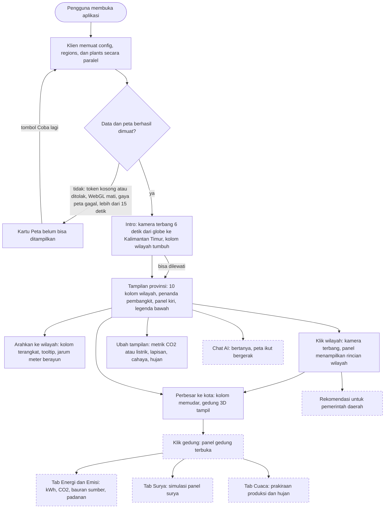
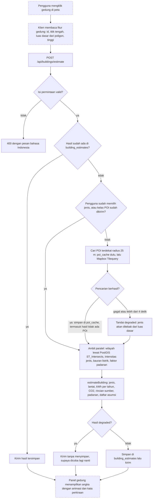
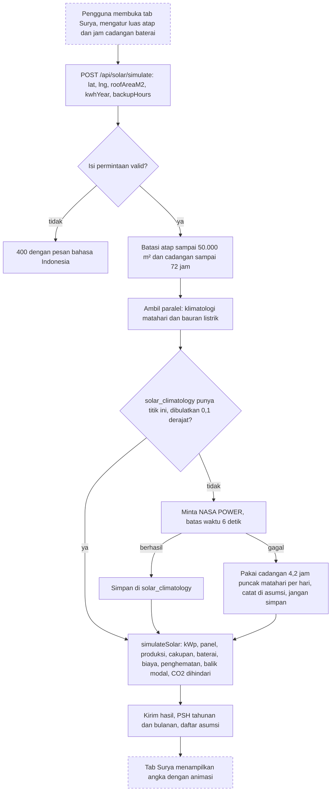
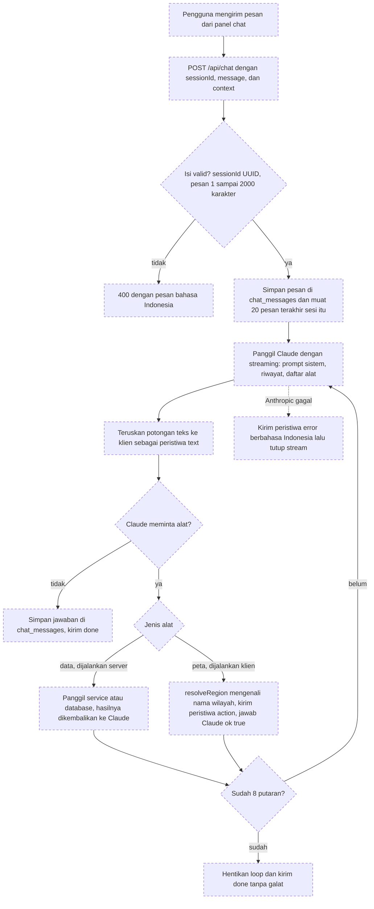
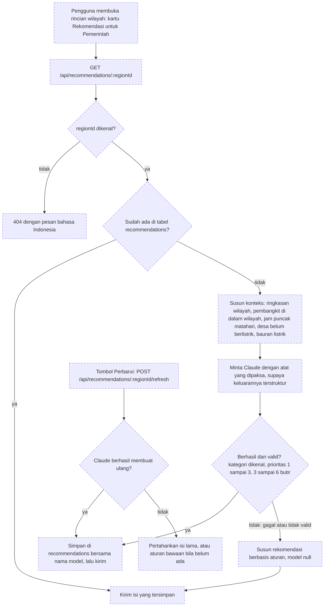
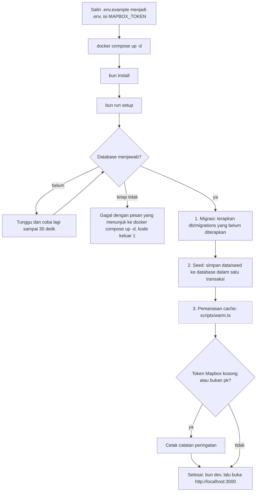

<!-- Penanda "(diverifikasi ulang di T11b)" menandai bagian yang bergantung pada kode yang belum digabung saat draf ini ditulis (chat AI, rekomendasi, panel gedung, tab surya dan cuaca, hujan otomatis). Hapus penandanya setelah bagian itu diperiksa terhadap kode akhir. Kotak putus-putus di diagram memakai penanda yang sama. -->

# Alur aplikasi dan flowchart

Dokumen ini memuat alur pemakaian aplikasi dan flowchart tiap fitur utama. Diagram memakai Mermaid, jadi tampil langsung di GitHub dan bisa diekspor ke gambar untuk PDF. Kotak putus-putus adalah langkah yang dibangun di tahap lain dan belum diperiksa terhadap kode akhir (diverifikasi ulang di T11b).

Isi dokumen:

1. [Alur aplikasi](#1-alur-aplikasi)
2. [Klik gedung sampai perkiraan](#2-klik-gedung-sampai-perkiraan)
3. [Simulasi panel surya](#3-simulasi-panel-surya)
4. [Prakiraan cuaca dan hujan](#4-prakiraan-cuaca-dan-hujan)
5. [Chat AI dan loop alat](#5-chat-ai-dan-loop-alat)
6. [Rekomendasi untuk pemerintah](#6-rekomendasi-untuk-pemerintah)
7. [Alur pemasangan lokal](#7-alur-pemasangan-lokal)

## 1. Alur aplikasi

Gambaran perjalanan pengguna, dari membuka aplikasi sampai memakai semua fitur.

Langkah yang sudah ada di kode saat ini (A sampai J): pemuatan data, kartu kegagalan, intro, tampilan provinsi, hover, klik wilayah, saklar metrik, lapisan, cahaya, dan hujan, serta perbesar ke kota. Langkah K sampai P (panel gedung, tab Surya dan Cuaca, chat AI, rekomendasi) dibangun di Task 7 sampai 10 (diverifikasi ulang di T11b).

Beberapa aturan di alur ini:

- Tiga permintaan awal (`/api/config`, `/api/regions`, `/api/plants`) berjalan paralel. Bila salah satu gagal, atau token Mapbox kosong, pengguna melihat kartu "Peta belum bisa ditampilkan" dengan tombol "Coba lagi", bukan layar kosong.
- Intro bisa dilewati dengan tombol "Lewati intro", tombol Esc, spasi, Enter, atau gerakan apa pun di peta. Bila sistem meminta gerak dikurangi, kamera langsung melompat.
- Kolom wilayah memendek mulai pembesaran 6,6 dan hilang di pembesaran 12, saat gedung 3D Mapbox mengambil alih.
- Cahaya peta mengikuti jam WITA (fajar, siang, senja, malam) kecuali presenter mengunci lewat saklar "Cahaya" atau `?cahaya=`.
- Setiap angka perkiraan diberi kata "perkiraan".

## 2. Klik gedung sampai perkiraan

Dari klik pada sebuah gedung sampai angka listrik, CO2, dan padanannya. Bagian server (`POST /api/buildings/estimate`) sudah ada. Bagian klien (membaca fitur gedung, panel) dibangun di Task 7 (diverifikasi ulang di T11b).

Langkah di server (`src/server/routes/buildings.ts` dan `src/shared/estimate.ts`):

1. **Periksa isi.** `featureId`, `lng`, `lat`, dan `footprintM2` wajib ada dan bertipe benar. `typeOverride` harus salah satu dari 12 jenis. Isi yang salah dijawab 400.
2. **Cache.** Kunci cache memuat id gedung, pilihan pengguna, luas dasar yang dibulatkan, dan kelas POI. Bila luas atau POI berubah, hasil dihitung ulang.
3. **Jenis gedung.** Bila pengguna memilih jenis atau klien sudah mengirim kelas POI, pencarian POI dilewati. Bila tidak, server mencari POI terdekat dalam radius 25 m (`poi_cache`, lalu Tilequery). Kelas POI diubah menjadi jenis gedung (misalnya `education` tipe `school` menjadi `sekolah`). Tanpa POI yang cocok, jenis ditebak dari luas dasar: di bawah 250 m² rumah, di bawah 2.000 m² ruko, selebihnya gudang. Tebakan itu dicatat di daftar asumsi.
4. **Jumlah lantai.** Bila peta punya tinggi lebih dari 3 m: tinggi ÷ 3,5 m dibulatkan. Bila tidak, dipakai jumlah lantai umum jenis itu. Hasilnya dijepit ke 1 sampai 40.
5. **Energi dan emisi.** `kWh per tahun = luas dasar × lantai × intensitas jenis`, `CO2 = kWh × 1,14 kg/kWh`. Rincian per sumber (batubara, gas, diesel, dan lain-lain) dibagi menurut bauran listrik tetapi totalnya disamakan dengan angka resmi. Padanan (km mobil, motor, pohon, charge HP, penerbangan) dihitung dari kg CO2.
6. **Wilayah.** PostGIS mencari wilayah yang memuat titik itu. Di luar Kalimantan Timur hasilnya `region: null`, dan perkiraan tetap dibuat dengan faktor emisi Kaltim (dicatat di daftar asumsi).
7. **Luas ekstrem.** Luas dasar dijepit ke 10 sampai 50.000 m² supaya tidak ada `NaN` atau angka tak masuk akal.
8. **Simpan.** Hasil disimpan kecuali pencarian POI gagal (`degraded`), supaya perkiraan tanpa data POI tidak menempel di cache.

Rumus dan tabel angkanya ada di [architecture.md](architecture.md#4-perkiraan-satu-gedung).

## 3. Simulasi panel surya

Dari luas atap dan konsumsi listrik gedung sampai biaya dan balik modal. Bagian server (`POST /api/solar/simulate`) sudah ada. Tab Surya di panel gedung dibangun di Task 9 (diverifikasi ulang di T11b).

Langkah di server (`src/server/routes/solar.ts` dan `src/shared/solar.ts`):

1. **Periksa isi.** `lat` dan `lng` dalam rentang, `roofAreaM2` dan `kwhYear` lebih dari 0, `backupHours` 0 atau lebih. Atap dibatasi 50.000 m² dan cadangan 72 jam.
2. **Radiasi matahari.** Rata-rata tahunan `ALLSKY_SFC_SW_DWN` dari NASA POWER (klimatologi 25 tahun, kWh/m²/hari, yaitu jam puncak matahari) di titik gedung. Hasil disimpan permanen per titik 0,1 derajat. Bila NASA POWER tidak terjangkau dan belum ada cache, dipakai 4,2 jam per hari dengan catatan di daftar asumsi, dan nilai itu tidak disimpan.
3. **Ukuran sistem.** Hasil per kWp = PSH × 365 × 0,78. Kapasitas dipilih sebesar kebutuhan (dibulatkan naik ke 0,5 kWp) tetapi tidak melebihi kapasitas atap (60% luas atap ÷ 5,5 m² per kWp, dibulatkan turun ke 0,5 kWp).
4. **Hasil.** Produksi per tahun, cakupan kebutuhan, ukuran baterai untuk jam cadangan yang dipilih, biaya (Rp 15 juta per kWp dan Rp 2,5 juta per kWh baterai), penghematan (tarif Rp 1.444,70 per kWh), balik modal sederhana, dan CO2 yang dihindari (× 1,14).
5. **Asumsi ikut dikirim.** Tarif, harga, dan catatan cadangan ada di `assumptions`, supaya angka tidak tampil tanpa dasar.

Batasan metodenya (neraca tahunan, balik modal sederhana) dijelaskan di [architecture.md](architecture.md#6-simulasi-panel-surya).

## 4. Prakiraan cuaca dan hujan

Dua hal yang berkaitan dengan cuaca: prakiraan produksi panel (data dari Open-Meteo) dan efek hujan di peta. Route `GET /api/weather`, saklar "Hujan" di legenda, dan efek hujannya sudah ada. Tab Cuaca dan hujan otomatis dibangun di Task 9 (diverifikasi ulang di T11b).

```mermaid
flowchart TD
  subgraph Data["Prakiraan produksi panel"]
    A["Tab Cuaca meminta GET /api/weather dengan lat, lng, dan kWp"] --> B{"lat, lng, kWp valid?"}
    B -->|tidak| B1["400 dengan pesan bahasa Indonesia"]
    B -->|ya| C{"weather_cache titik ini, dibulatkan 0,05 derajat, masih segar kurang dari 1 jam?"}
    C -->|ya| F
    C -->|tidak| D["Minta Open-Meteo: radiasi, awan, hujan, kode cuaca per jam, 7 hari, batas waktu 6 detik"]
    D -->|berhasil| E["Simpan di weather_cache"]
    E --> F
    D -->|gagal| D1{"Ada cache lama?"}
    D1 -->|ya| D2["Pakai cache lama dan tandai stale true"]
    D2 --> F
    D1 -->|tidak| D3["503: Prakiraan cuaca sedang tidak tersedia"]
    F["pvFromForecast: kWp x radiasi per 1.000 x 0,78 tiap jam, ringkasan harian, jam dan hari hujan, kondisi saat ini"] --> G["Jawaban: hours, days, current, stale"]
    G --> H["Grafik 72 jam dan kartu harian di tab Cuaca"]
  end

  subgraph Peta["Efek hujan di peta"]
    R1{"Mode hujan"} -->|"Hujan dinyalakan di legenda"| R2["setRainEffect menyalakan map.setRain"]
    R1 -->|"Otomatis"| R3["Tiap 10 menit dan setelah kamera berpindah jauh, ambil cuaca di pusat peta"]
    R3 -->|"current.raining bernilai true"| R2
    R2 --> R4{"Pembesaran 15 atau lebih?"}
    R4 -->|tidak| R5["Hujan belum terlihat, legenda memberi petunjuk perbesar sampai tingkat gedung"]
    R4 -->|ya| R6["Garis hujan tipis, di peta terang ditambah kabut, dan tint mendung"]
  end

  classDef pending stroke-dasharray: 5 4
  class A,H,R3 pending
```

Aturan penting:

- **Open-Meteo** dipanggil dengan variabel `shortwave_radiation`, `cloud_cover`, `precipitation`, dan `weather_code`, zona waktu Asia/Makassar (WITA), 7 hari. Titik dibulatkan ke 0,05 derajat (sekitar 5 km) agar banyak klik berdekatan memakai satu cache.
- **Produksi panel per jam** = kWp × radiasi ÷ 1.000 × 0,78. Mendung dan hujan sudah tercermin di nilai radiasi.
- **Hujan.** Satu jam dianggap hujan bila curahnya 0,1 mm atau lebih atau kode cuacanya hujan. Satu hari dianggap hujan bila ada jam dengan 0,5 mm atau lebih atau kode hujan. Ringkasan harian menandai hari hujan dan jumlah produksi hari itu.
- **Kondisi saat ini** (`current`) diambil dari jam prakiraan yang paling dekat dengan waktu sekarang: sedang hujan atau tidak, tutupan awan, curah, dan apakah masih siang.
- **Bila Open-Meteo gagal**, prakiraan lama dari cache tetap dipakai dan ditandai `stale: true`. Tanpa cache sama sekali, server menjawab 503 dengan pesan ramah, dan klien menampilkan pesan itu.
- **Efek hujan di peta** memakai `map.setRain` dengan garis hujan tipis. Efek mulai terlihat di pembesaran 15 (tingkat gedung) dan penuh di 16,5, jadi tampilan provinsi dan kota tidak pernah ditutupi hujan. Saklar "Hujan" di legenda sudah ada. Mode otomatis yang membaca `current.raining` dibangun di Task 9 (diverifikasi ulang di T11b).

## 5. Chat AI dan loop alat

Pengguna bertanya dalam bahasa Indonesia, dan Claude menjawab sambil menggerakkan peta. Angka hanya boleh berasal dari alat yang membaca data aplikasi, bukan dari ingatan model. Seluruh bagian ini dibangun di Task 8 (diverifikasi ulang di T11b).

Ketentuan (dari rancangan Task 8, diverifikasi ulang di T11b):

- **Model dan batas.** `claude-sonnet-5-5`, `max_tokens` 2048, paling banyak 8 putaran alat untuk satu pesan, tanpa pembatasan laju.
- **Peristiwa SSE ke klien**: `text` (potongan jawaban), `action` (perintah untuk peta), `done`, dan `error`.
- **Alat data (dijalankan server, hasilnya dikembalikan ke Claude)**: `get_region_stats`, `list_regions`, `get_grid_mix`, `estimate_building_at`, `simulate_solar`, `get_weather`, dan `get_recommendations`. Semuanya memakai layanan dan database yang sama dengan API biasa.
- **Alat peta (dijalankan klien)**: `fly_to_region`, `fly_to`, `select_building_at`, `toggle_layer`, `set_metric`, `set_rain`, dan `open_tab`. Server mengirim peristiwa `action` dan langsung menjawab Claude `{ ok: true }`. Klien yang menjalankannya.
- **Nama wilayah.** `resolveRegion` mengubah "Kukar", "balikpapan", atau "Kota Samarinda" menjadi id wilayah sebelum aksi dikirim. Nama yang tidak dikenali dijawab sebagai galat ke Claude dan tidak mengirim aksi.
- **Riwayat.** Pesan pengguna dan jawaban disimpan di `chat_messages` per sesi anonim, dan 20 pesan teks terakhir dimuat sebagai riwayat.
- **Kegagalan.** Bila Anthropic gagal, klien menerima peristiwa `error` dengan pesan bahasa Indonesia lalu stream ditutup. Bila klien memutus koneksi, permintaan ke Anthropic dibatalkan.
- **Panduan jawaban.** Prompt sistem berbahasa Indonesia: peran sebagai asisten energi Kalimantan Timur, jelaskan untuk orang awam, angka hanya dari alat, tulis "perkiraan" untuk angka perkiraan, jawab singkat, dan tunjukkan yang dibahas lewat aksi peta.

## 6. Rekomendasi untuk pemerintah

Rekomendasi pembangunan berkelanjutan dan tata ruang untuk tiap kabupaten dan kota, ditulis Claude dari data wilayah itu, disimpan di database, dan punya cadangan berbasis aturan. Seluruh bagian ini dibangun di Task 10 (diverifikasi ulang di T11b).

Ketentuan (dari rancangan Task 10, diverifikasi ulang di T11b):

- **Bentuk jawaban.** `{ regionId, items, model, generatedAt }`. Tiap butir berisi judul, kategori (`energi_terbarukan`, `efisiensi`, `tata_ruang`, `akses_listrik`, `kebijakan`), isi, dampak, dan prioritas 1 sampai 3.
- **Berdasar data.** Konteks yang diberikan ke Claude hanya angka dari aplikasi: ringkasan wilayah, pembangkit di dalam wilayah (kueri spasial `ST_Contains`), jam puncak matahari, desa yang belum berlistrik, dan bauran listrik. Claude diminta memakai angka itu saja, menulis dalam bahasa Indonesia untuk pemerintah daerah, spesifik untuk wilayahnya, dan menyebut angka perkiraan sebagai "perkiraan".
- **Cadangan berbasis aturan.** Bila Claude gagal atau hasilnya tidak valid, server menyusun butir dari data: banyak desa belum berlistrik menjadi usulan PLTS komunal, bauran batubara yang tinggi menjadi usulan PLTS atap gedung pemerintah, konsumsi per orang yang tinggi menjadi usulan efisiensi, ditambah butir tata ruang dan kebijakan. Hasil ini bertanda `model: null`.
- **Pemanasan.** `bun run setup` membuat rekomendasi untuk 10 wilayah bila `ANTHROPIC_API_KEY` ada, sehingga demo tidak menunggu model.

## 7. Alur pemasangan lokal

Dari repositori kosong sampai aplikasi berjalan. Langkahnya sama dengan panduan di [README](../../README.md). Skrip `scripts/setup.ts` sudah ada dan sudah diuji.

- Tiap langkah mencetak satu baris status dalam bahasa Indonesia, dan setup berhenti dengan kode keluar 1 bila ada langkah yang gagal.
- Setup aman diulang: migrasi yang sudah diterapkan dilewati, dan seed memakai `ON CONFLICT DO UPDATE`.
- Bila pemanasan cache gagal, migrasi dan seed sudah selesai dan aplikasi tetap bisa dijalankan. Pemanasan bisa diulang dengan `bun run warm`.
- Pemanasan cache mengisi klimatologi NASA di pusat tiap wilayah dan rekomendasi 10 wilayah (bila kunci Anthropic ada). Bila `scripts/warm.ts` tidak ada, langkah itu dilewati dengan catatan (diverifikasi ulang di T11b).
